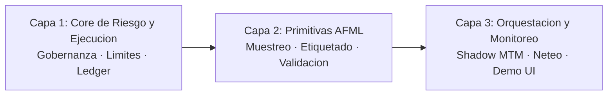

# Trading Research Methodology

**Marco abierto de investigación cuantitativa, auditoría de estrategias refutadas, control de fricción y registro prospectivo en criptoactivos.**

Este repositorio documenta el método científico, los protocolos anti-overfitting, los fracasos empíricos fuera de muestra y las prácticas de ingeniería de riesgo utilizadas en investigación sistemática sobre futuros perpetuos cripto. El motor propietario de ejecución permanece privado; aquí se expone exclusivamente metodología auditable y evidencia pública reproducible en diseño.

---

## Principio rector

En trading algorítmico, una captura aislada de ganancias sin trazabilidad genera desconfianza legítima. Lo que construye credibilidad técnica verificable es documentar:

1. **Qué hipótesis murieron** al someterlas a datos fuera de muestra, latencia y comisiones reales.
2. **Cuánto sesgo de selección** existe al explorar múltiples variantes sobre una misma ventana histórica.
3. **Cómo se separan** la simulación histórica, la ejecución en cuenta demo con configuración congelada y la gobernanza de riesgo operacional.

---

## Arquitectura conceptual en tres capas

---

## Mapa del repositorio

| Documento | Contenido principal |
| :--- | :--- |
| [01 — Cementerio de Estrategias Refutadas](docs/01_REFUTED_STRATEGY_GRAVEYARD.md) | Evidencia cuantitativa de familias descartadas tras comisiones reales y OOS |
| [02 — Protocolo Anti-Overfitting y Fricción](docs/02_ANTI_OVERFITTING_AND_FRICTION_PROTOCOL.md) | Reglas causales, matriz de `4` regímenes de costos, Block Bootstrap y DSR |
| [03 — Arquitectura y Gobernanza de Riesgo](docs/03_ARCHITECTURE_AND_RISK_GOVERNANCE.md) | Separación en `3` capas, neteo inter-motores, higiene de secretos y modo demo |
| [04 — Bitácora Prospectiva Congelada](docs/04_PROSPECTIVE_LIVE_LOG.md) | Protocolo no retroactivo iniciado el 19 de noviembre de 2026 |
| [05 — Playbook de Publicación Técnica](docs/05_CONTENT_PLAYBOOK_SOCIAL.md) | Guiones y publicaciones listos para LinkedIn, X, Instagram y TikTok |

---

## Descargo de responsabilidad y alcance

Todo el contenido de este repositorio tiene carácter estrictamente educativo, metodológico y de ingeniería estadística. No constituye asesoría financiera, recomendación de inversión ni oferta o promesa de rentabilidad futura. Cada resultado histórico citado corresponde a simulaciones bajo supuestos explícitos de fricción y se distingue explícitamente de la recolección prospectiva en cuentas Demo.
