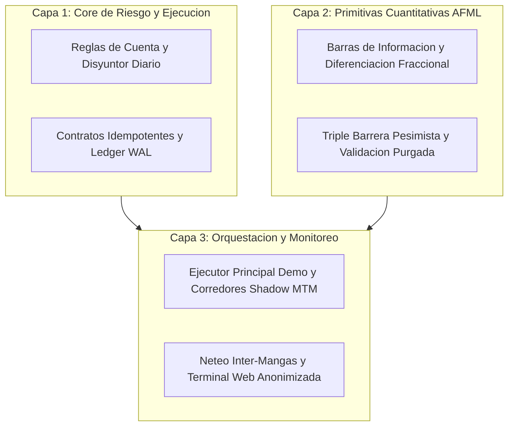
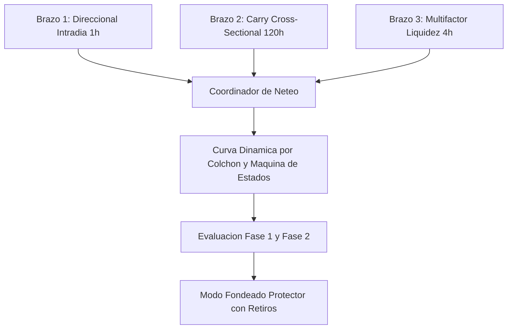

# 03 — Arquitectura Conceptual y Gobernanza de Riesgo

---

## 1. Separación estricta de responsabilidades en tres capas

---

## 2. Arquitectura de neteo inter-mangas y transiciones de etapa

En carteras compuestas por múltiples estrategias con bajas correlaciones entre sí, ejecutar cada brazo de manera aislada provoca cruces opuestos innecesarios y doble pago de comisiones. El coordinador central consolida el libro neto antes de contabilizar exposición:

- **Regla anti-solapamiento:** cuando dos mangas ordenan posiciones opuestas sobre el mismo activo, se compensan en libro neto antes de exponer capital o pagar comisiones duplicadas.
- **Disyuntor diario y cooldown causal:** pérdidas consecutivas sobre un mismo activo activan pausas causales automáticas sin modificar parámetros durante la ejecución en vivo.
- **Asimetría entre evaluación y preservación:** una vez superadas las metas de evaluación, la gobernanza conmuta automáticamente hacia multiplicadores protectores que reducen la varianza alrededor del suelo de cuenta.

---

## 3. Higiene operacional y captura segura para auditoría pública

1. **Carga fail-closed de variables de entorno:** la configuración local se resuelve de forma explícita y nunca hereda silenciosamente archivos `.env` de directorios superiores salvo bandera explícita de entorno.
2. **Snapshots HTML excluidos del control de versiones:** los artefactos visuales generados con telemetría viva permanecen ignorados en Git para impedir confirmaciones accidentales con saldos o posiciones reales.
3. **Modo Demo Anonimizado en UI y API:** mediante variable de entorno `ECS_TERMINAL_DEMO_MODE=1` o parámetro de consulta `?demo=1`, la interfaz enmascara saldos USD, nocionales, fills, anotaciones de clave API, identificadores cloud e historial monetario, y bloquea mutaciones con código HTTP `403`, manteniendo visibles la arquitectura, el cumplimiento de compuertas de riesgo y el progreso porcentual.
4. **Auditoría del historial Git:** antes de publicar documentación técnica se verifica mediante escaneo de historial que no existan credenciales de exchange, claves privadas ni tokens en el árbol activo ni en ramas archivadas.
